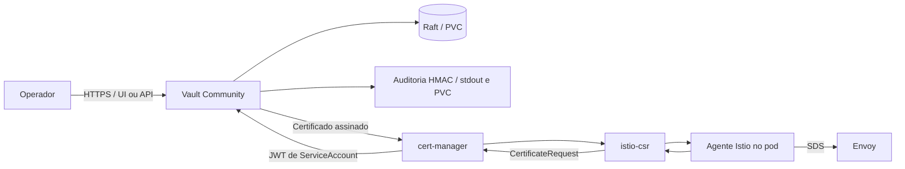

# Arquitetura e confiança

## Componentes

- **Vault:** API, console e políticas. O mecanismo PKI guarda a chave da CA e assina solicitações autorizadas.
- **Raft:** armazenamento integrado. O PVC conserva o estado em reinícios; não é backup independente nem alta disponibilidade.
- **Service CA do OpenShift:** emite o certificado HTTPS do Service Vault. Isso permite instalar o Vault antes de configurar sua PKI, sem dependência circular.
- **CA raiz pki-root e intermediária pki-mesh:** cadeia dos certificados de laboratório. As duas ficam na mesma instância neste perfil; a separação é lógica. Uma raiz externa/offline exige outro procedimento.
- **Issuer Vault:** aponta o cert-manager para o endpoint de assinatura e para uma identidade Kubernetes permitida.
- **istio-csr:** autentica solicitações dos workloads e usa cert-manager para obter certificados assinados pelo Vault.
- **Envoy e agente Istio:** utilizam os certificados de identidade para mTLS e renovam pelo serviço de CA. Certificados de workloads são entregues por SDS; não precisam ser copiados manualmente para cada Deployment.

O Vault atende emissão/renovação. O tráfego HTTP entre aplicações passa pelos proxies. PeerAuthentication exige mTLS; AuthorizationPolicy decide quais identidades/operações podem acessar; NetworkPolicy limita conexões por pods/portas. Esses controles têm funções distintas.

## Duas relações TLS

1. cert-manager → Vault: certificado HTTPS assinado pela Service CA do OpenShift; o Issuer usa vault-server-ca para validar o servidor.
2. proxy → proxy: certificados assinados pela intermediária do Vault; a raiz pública é distribuída por istio-csr.

A raiz pública fixada em vault-mesh-root evita depender da descoberta automática de uma CA. Chaves privadas das CAs ficam no Vault. Certificados de servidor/plano de controle gerados pelo cert-manager ficam em Secrets Kubernetes, sujeitos ao RBAC do cluster.

## Identidades e limites

A ServiceAccount vault faz TokenReview usando system:auth-delegator. A conta vault-issuer, em istio-vault-system, recebe somente a policy mesh-sign no Vault. O cert-manager pode pedir tokens dessa conta específica por RBAC; não há token Kubernetes estático no manifesto. A conta vault-operator recebe uma policy administrativa limitada às PKIs do laboratório e tokens curtos.

A role de assinatura aceita nomes DNS de laboratório/serviços do plano de controle e URIs SPIFFE dos namespaces do mesh de teste. Ela não autoriza nomes arbitrários. O TTL máximo dos certificados dessa role é uma hora.

A NetworkPolicy do Vault restringe **ingress** aos namespaces de consumidores, ingresso e monitoramento; não implementa bloqueio geral de egress. O acesso pela Route exige autenticação Vault. Argo CD reconcilia recursos Kubernetes, sem inicializar, deslacrar ou guardar automaticamente as chaves de recuperação.
